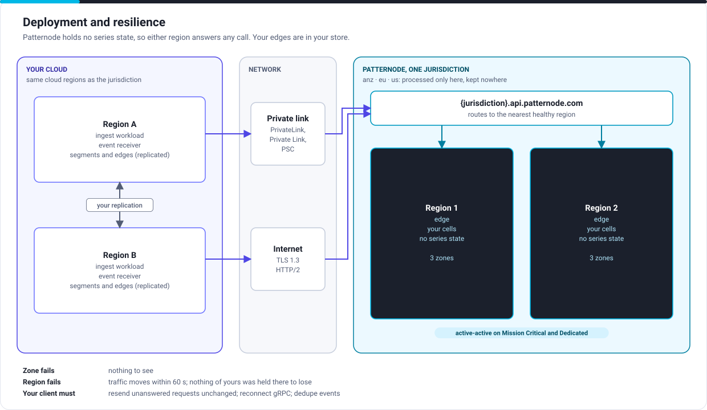

# Deployment and resilience

For solution architects and the engineers who run the integration.

## What runs where

| Layer | Production plan | Mission Critical and Dedicated |
|---|---|---|
| Jurisdiction | One, chosen at onboarding: `anz`, `eu` or `us` | The same |
| Patternode regions | One region, three zones; a second region of the jurisdiction on standby | Two regions, active-active, each with three zones, holding no series state |
| Isolation | Shared cells | Shared cells (Mission Critical) or cells for you alone (Dedicated) |
| Endpoint | `{jurisdiction}.api.patternode.com`, or `api.patternode.com` for your home jurisdiction | The same, plus a private endpoint |
| Your callers | Anywhere with outbound HTTPS | In the same cloud regions as the jurisdiction, ideally two, connected privately |

## Placing your side

| Decision | Recommendation |
|---|---|
| Cloud region for your ingest workload | The same cloud and region family as your jurisdiction, so the network share of your latency budget is small and steady |
| Number of regions | One for Production. Two for Mission Critical, active-active or warm standby, with your segment store and series registry replicated |
| Connectivity | Internet with TLS for Production. AWS PrivateLink, Azure Private Link or Google Private Service Connect for Mission Critical, and the only route if you ask |
| Endpoint | Always the jurisdiction endpoint, never an address you resolved once: failover moves it |
| Connections | HTTP/2, kept open and reused; one gRPC connection carries many series |

## When something fails

| Failure | You see | Your client must |
|---|---|---|
| A Patternode zone | Nothing | Nothing |
| A Patternode region (Mission Critical) | Up to 60 seconds of 503s or resets, then normal service from the other region | Resend unanswered requests unchanged; reconnect gRPC; deduplicate events |
| A region degraded but up | A drain: the same as a failover, without errors | The same |
| Patternode overloaded or your plan's rate exceeded | 429 or 503 with `retry-after` | Wait as told, then resend unchanged |
| Your region | Whatever your design allows | Fail over your own callers; carry each series on from the edge in your replicated store |
| The network between you | Timeouts | Retry; consider private connectivity |

Patternode holds none of your series, so none is lost in any of these: your edges are in your store. Recovery objectives by plan are in [Resilience](../service/resilience.md#recovery-objectives).

## Change and maintenance

Mission Critical and Dedicated customers set blackout periods (trading hours, emergency declarations) in which nothing changes in their cells. Releases go out a cell at a time and roll back automatically on regression. A quarterly regional failover test is run in production and its results shared.

Next: [Security and data](security.md).
