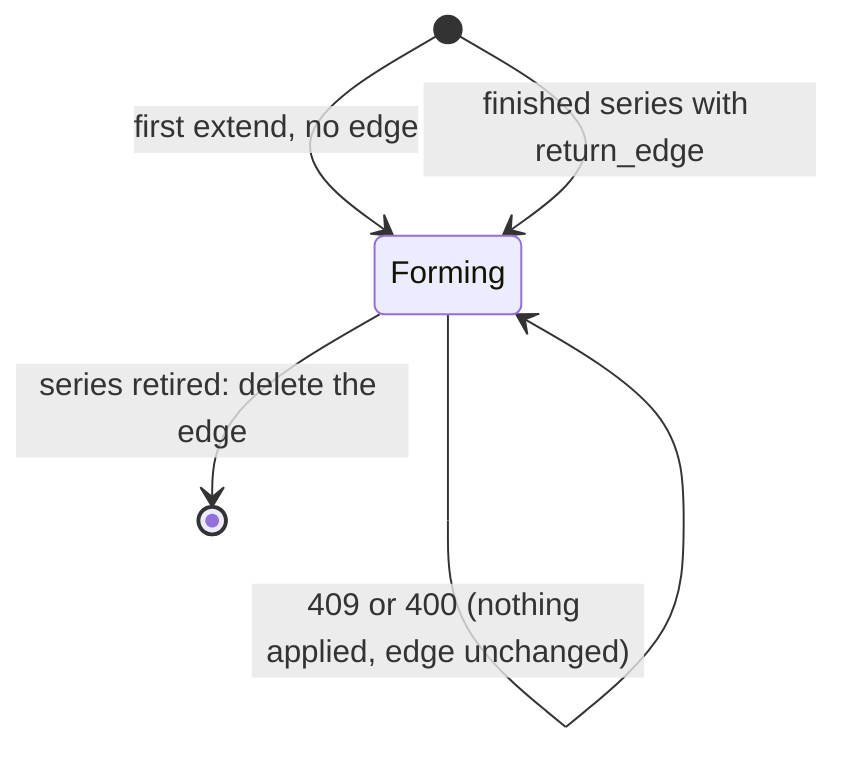

# Detailed flows

For engineers building the integration. Each flow names every call and what your code does when something goes wrong. The contract for each call is in the [API reference](/api/patternode-api); the events are in [Events](../events/index.md).

## Finished series

```mermaid
sequenceDiagram
  autonumber
  participant C as Collector and bar builder
  participant I as Ingest workload
  participant K as Key vault
  participant P as Patternode API
  participant S as Segment store
  I->>K: read live key (at start, cached)
  C->>I: bars for one series window
  I->>P: POST /v1/segmentations {series, profile, bars}<br/>Authorization, x-amz-content-sha256, Idempotency-Key
  alt 200
    P-->>I: segments (every level), profile_version
    I->>S: upsert by id; replace provisional, keep final
  else 429 or 503
    P-->>I: retry-after
    I->>P: same request, same Idempotency-Key, after the wait
  else 400 invalid_series
    P-->>I: problems [index, problem]
    I->>C: fix the named bars; do not retry unchanged
  end
```

## Forming series: the edge travels with you

Patternode keeps nothing between calls. The series' state is its edge, which lives in your segment store and is sent with each new bar.

```mermaid
sequenceDiagram
  autonumber
  participant I as Ingest workload
  participant S as Segment store
  participant P as Patternode (any region)
  I->>P: POST /v1/segmentations/extend {series, profile, bars} (no edge)
  P-->>I: closed, right_edge, edge, edge_last_close_time
  I->>S: one write: closed (final), right edge, edge, version 1
  loop each bar as it closes
    I->>S: read edge (version n)
    I->>P: POST /v1/segmentations/extend {series, edge, bars}
    P-->>I: closed, right_edge, a new edge
    I->>S: one write, if still version n: closed, right edge, edge, version n+1
  end
  Note over P: a region fails; the endpoint moves within 60 s
  I-xP: extend (timeout or 503)
  I->>P: the same request, unchanged (retry with backoff)
  P-->>I: the same answer the first attempt would have given
```

Rules your code keeps:

| Situation | Answer | Do |
|---|---|---|
| A retried request | The same answer, whichever region gives it | Store it as usual |
| A bar before the edge's last close | 409 `out_of_order` | Drop it, or rebuild the window as a finished series |
| An edge from another series or profile version | 409 `edge_mismatch` | Read this series' edge from your store |
| A changed or truncated edge | 400 `edge_invalid` | Store edges as opaque strings, exactly as received |
| Two writers on one series | Both answers are valid | Keep the first write: a version check in your store |
| Your workload restarted | | Read the edge from your store and carry on |
| You lost a series' edge | | Send the series again as a finished series with `return_edge: true` |

The life of a forming series, on your side:



## Backfill, with a webhook

```mermaid
sequenceDiagram
  autonumber
  participant I as Ingest workload
  participant B as Your storage
  participant P as Patternode API
  participant W as Event receiver
  participant Q as Queue and workers
  participant S as Segment store
  I->>B: put the file; presign GET (source) and PUT (result)
  I->>P: POST /v1/segmentations/jobs {series, kind, format, source_url, result_url, return_edge}
  P-->>I: 202 job queued
  P->>B: GET source_url
  P->>B: PUT result_url
  P->>W: segmentation.job.succeeded (signed)
  W->>W: verify signature on raw body; reject stale; drop seen id
  W-->>P: 204 within 10 s
  W->>Q: enqueue job id
  Q->>B: read the result
  Q->>S: store segments (and the edge, to carry on live)
  Note over Q: on failure the message goes to the dead-letter queue
```

## Rotating credentials without downtime

```mermaid
sequenceDiagram
  autonumber
  participant A as Admin (person)
  participant P as Patternode API
  participant K as Key vault
  participant I as Ingest workload
  participant W as Event receiver
  A->>P: POST /v1/keys {kind: live, scopes, expires_in_days: 90}
  P-->>A: the new key, shown once
  A->>K: put as the current version
  I->>K: picks up the new version (restart or cache expiry)
  A->>P: GET /v1/keys: old key's last_used_at stops moving
  A->>P: DELETE /v1/keys/{old}
  A->>P: POST /v1/account/webhook_secret
  P-->>A: new secret; deliveries now carry both signatures
  A->>K: {current: new, previous: old}
  W->>K: accepts either signature
```

Next: [Decisions you make](decisions.md).
