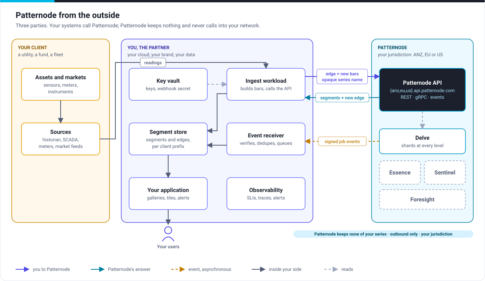
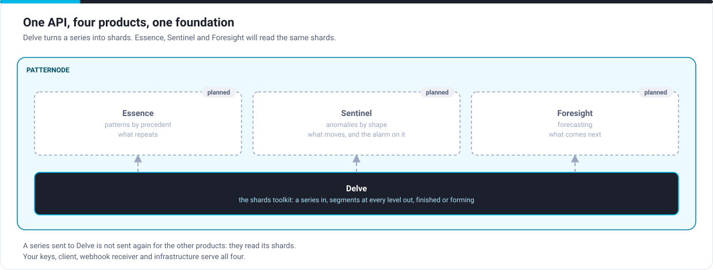

# Architecture overview

For enterprise and solution architects: the whole picture in one page. Each section links to the detail an engineer needs, so you can stop reading at the level you need.

## The picture

Three parties:

| Party | Owns | Runs |
|---|---|---|
| Your client (a utility, a fund, a fleet operator) | Assets, readings, the relationship with you | Historians, SCADA, meters, market feeds |
| You, the partner | Your product, your brand, your data and your keys | An ingest workload, a segment store, an event receiver, your application |
| Patternode | The service | The Patternode API: Delve today; Essence, Sentinel and Foresight on the same foundation |

## The architecture at a glance

| Concern | Answer |
|---|---|
| Integration style | API-first. Your backend calls Patternode; Patternode answers and sends events. No agent, connector or software of Patternode's runs in your environment |
| Direction | Outbound only from your side. Patternode never connects into your network; events reach an endpoint or event bus you choose |
| Interfaces | REST and JSON (OpenAPI 3.1) on every plan; gRPC on Mission Critical and Dedicated; webhooks and event-bus delivery (AsyncAPI 3.1); bulk files (CSV, JSON Lines, Parquet, Arrow) read from and written to your storage |
| Interaction | Synchronous for a finished series and for each extension of a forming series; asynchronous for backfill jobs and events |
| What crosses | Bars (time, open, high, low, close) under a series name you make up. Segments come back. Nothing else |
| Where data lives | Everything about your series is in your store: readings, segments, and for a forming series its edge. Patternode keeps none of it, not even between calls |
| Residency | You choose a jurisdiction (Australia and New Zealand, the EU or the US); data never leaves it |
| Identity | API keys on every plan; OAuth 2.0 client credentials with signed assertions, mutual TLS and workload identity on Mission Critical and Dedicated |
| Resilience | Up to 99.99% availability, active-active across two regions, 60-second regional failover, nothing acknowledged lost ([Plans](../service/plans.md)) |
| Semantics | Stateless: the same edge and bars always give the same answer, so retries are exactly-once in effect; at-least-once events; deterministic results per pinned profile version |
| Change | One functional contract for every plan, product and industry; versioned in the path; changes announced in the [changelog](../resources/changelog.md) |

## One API, every product

Integrate once. A series sent to Delve is not sent again for the products that run on it, and your keys, client, event receiver and infrastructure serve all of them.

## Architecture principles

1. Your data stays yours. Patternode receives the minimum (bars under opaque names) and keeps nothing, not even a forming series between calls. You store the results and the edge.
2. Outbound only. Nothing from Patternode connects into your network, which keeps it outside operational technology perimeters and simplifies your security review.
3. Contract first. The OpenAPI, AsyncAPI and gRPC files are the contract; this site, the mock server and the examples follow them.
4. One contract, many plans. Moving up a plan changes capacity and service levels, never your code.
5. Safe to retry. The same edge and bars always give the same answer, so a retry, a restart or a failover never double-counts or loses a bar.
6. Deterministic. The same bars with the same profile version give the same segments, always, so backtests, audits and live operation agree.
7. Your jurisdiction. Your series are processed only in the jurisdiction you choose, and support access stays there.
8. No lock-in. Segments and edges are already in your store, and the contract is published under Apache 2.0.

## Read next

| You are | Read |
|---|---|
| An enterprise architect checking fit | [Security and data](security.md), [Deployment and resilience](deployment.md), the [service contract](../service/index.md) |
| A solution architect designing the integration | [Integration architecture](integration.md), [Your side](partner-side.md), the [reference architectures](reference-architectures.md), [Decisions you make](decisions.md) |
| An engineer building it | [Detailed flows](flows.md), the [Quickstart](../get-started/quickstart.mdx), the [API reference](/api/patternode-api) |
| A project lead | The [onboarding playbook](../playbooks/delve-onboarding.md) |
