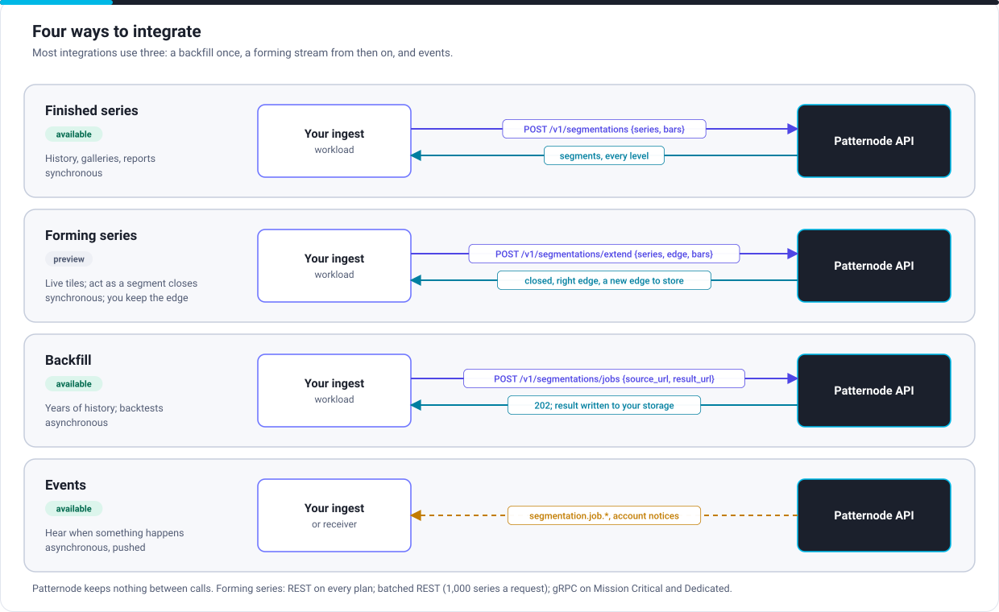
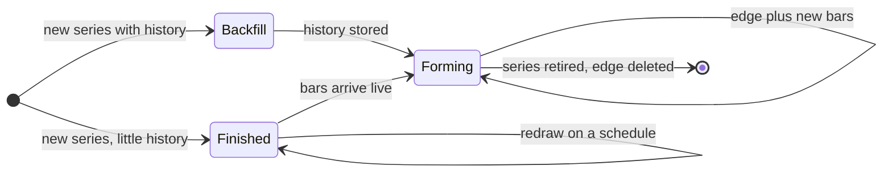

# Integration architecture

For solution architects. How your systems and Patternode's exchange data, and which style suits which need.

## Four styles

| Style | Interaction | Use for | Status |
|---|---|---|---|
| [Finished series](../guides/finished-series.mdx) | Request and response, one call per series window | History, galleries, reports, daily redraws | Available |
| [Forming series](../guides/forming-series.mdx) | Request and response: the stored edge plus new bars in, the new edge out | Live tiles; acting as a segment closes | Preview |
| [Backfill](../guides/backfill.mdx) | Asynchronous: a job reads your storage and writes the result back to it | Years of history, backtests, bodies over 5 MB | Available |
| [Events](../guides/webhooks.mdx) | Pushed to you: webhook or event bus | Jobs finishing, account notices | Available (webhooks) |

A typical integration combines them over a series' life:

## Interfaces and transports

Every transport carries the same operations with the same semantics; the faster ones are optimisations, not different APIs.

| Interface | Contract | Plans | Typical use |
|---|---|---|---|
| REST, JSON over HTTPS | `specs/openapi.yaml` | All | Everything; the reference |
| Batched REST extensions | `specs/openapi.yaml`, `POST /v1/segmentations/extend/batch` | All | Up to 1,000 series in one request, each with its edge |
| gRPC bidirectional stream | `specs/proto/patternode/delve/v1/delve.proto` | Mission Critical, Dedicated | Sustained high rates, low tail latency |
| Webhooks, signed to Standard Webhooks | `specs/asyncapi.yaml`, channel `webhook` | Production and above | Job results, account notices |
| Event bus (Amazon EventBridge, Kafka), CloudEvents 1.0 | `specs/asyncapi.yaml` | Mission Critical, Dedicated | Events into your own bus, without running a receiver |
| Bulk files (CSV, JSON Lines, Parquet, Arrow IPC) | `POST /v1/segmentations/jobs`, links to your storage | All | Backfills and backtests |

## Synchronous and asynchronous

| | Synchronous | Asynchronous |
|---|---|---|
| Calls | Finished series; each extension of a forming series | Jobs; every event |
| Your side needs | A client that resends unchanged with backoff, and a store that keeps segments and edge in one write | A receiver or consumer that verifies, deduplicates and answers fast |
| Ordering | Per series, by the edge's last close time | None; deduplicate and order by your own records |
| Delivery | Exactly-once effect: same edge and bars, same answer | At least once; deduplicate by event id |

## Contract governance

| Topic | Rule |
|---|---|
| Source of truth | The files in `specs/`. Pages, the mock and the examples follow them |
| Versioning | In the path (`/v1/`). No breaking change to an `available` operation within a version; a new version runs beside the old for at least 12 months |
| Status | Each operation and event carries `x-status`: `available`, `preview` (may change with 30 days' notice) or `planned` (specified, not yet served) |
| Extensions | An industry-only addition is an OpenAPI Overlay in `specs/overlays/`, never a change to the core |
| Compatibility | Clients must ignore unknown fields, enum values, event types and error codes |
| Determinism | Results are fixed per profile version; versions are served for at least 24 months |

Next: [Your side](partner-side.md), for what you build to use these interfaces.
