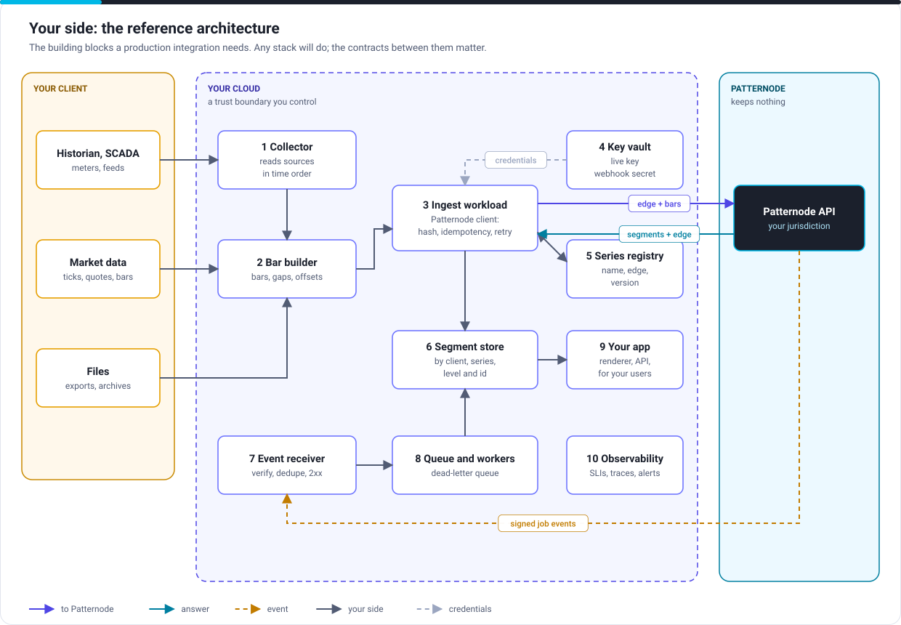

# Your side: the reference architecture

For solution architects and engineers. What a production integration needs in your environment. Any stack will do: what matters is the responsibility of each block and the contract it meets.

## The building blocks

| # | Block | Must | Example realisations |
|---|---|---|---|
| 1 | Collector | Read your sources in time order per series, and survive restarts without skipping or repeating | Historian client, feed handler, file watcher |
| 2 | Bar builder | Turn readings into bars: ordered, non-overlapping, values above zero (offset if needed), gaps left as gaps | Your code; `examples/python/bars.py` |
| 3 | Ingest workload | Call Patternode from your backend only: key header, body hash, idempotency key, retries with backoff and `retry-after`, the stored edge with each new bar, one writer per series | A service or function; `examples/*/client` |
| 4 | Key vault | Hold the live key (or OAuth signing key) and the webhook secret encrypted; readable only by blocks 3 and 7; versioned for rotation | AWS Secrets Manager, Azure Key Vault, Google Secret Manager, HashiCorp Vault |
| 5 | Series registry | Map each opaque series name to your client and asset; hold each forming series' edge with a version, in the same write as its segments | A table in your database; [the segment store](../guides/segment-store.mdx) |
| 6 | Segment store | Keep segments by client prefix, series, level and id; replace provisional segments, keep final ones; delete a client by deleting its prefix | Object storage, a time-series or relational database |
| 7 | Event receiver | Verify the signature on the raw body, reject stale timestamps, drop seen event ids, answer 2xx within 10 seconds, queue the work | A function behind HTTPS; or your event bus |
| 8 | Queue and workers | Do the work after the answer; retry; park failures in a dead-letter queue | SQS, Pub/Sub, Service Bus, Kafka |
| 9 | Your application | Read segments from your store, never from Patternode; draw each chart at the level it can read | Your product |
| 10 | Observability | Measure success rate, p99 latency, 429 rate, edge and out-of-order errors, event lag and dead-letter depth; propagate `traceparent` | Your monitoring and tracing stack |

[AWS with Terraform](../guides/aws-terraform.md) builds blocks 4, 6, 7 and 8 and the policy for 3.

## What Patternode assumes about your environment

| # | Assumption | If it does not hold |
|---|---|---|
| A1 | Your backend can make outbound HTTPS calls (and gRPC, if you use it) to your jurisdiction's endpoint | Use private connectivity, or an egress proxy that allows `*.api.patternode.com` |
| A2 | You have a secret store, and workloads read credentials from it at start | Introduce one before go-live; keys in code or images fail the [production checklist](../go-live/production-checklist.md) |
| A3 | You can identify each series stably, and keep the mapping from opaque name to client and asset yourself | Patternode cannot recover it: it never learns who or what a series is |
| A4 | You can deliver each series' bars in time order, with one writer per series, keeping its edge | Funnel each series through one writer (a partition key, a lock, an actor); a bar before the edge is refused. Lose an edge and you can rebuild it from the series' bars |
| A5 | You can store segments: plan for up to one segment record per bar you send, across all levels | Store only the levels you draw, and re-fetch history as a finished series when needed |
| A6 | Your bar times come from your sources; Patternode never changes them | Normalise time zones and clock offsets before building bars |
| A7 | An HTTPS endpoint can receive webhooks, or you use an event bus (Mission Critical) | Poll jobs instead of receiving webhooks; slower, but complete |
| A11 | For jobs, storage you can presign links in (S3, Azure Blob, Google Cloud Storage) | Send series inline in pieces of up to 5 MB instead |
| A8 | You can monitor and alert on your side of the integration | Build it before go-live; Patternode's status page covers only Patternode's side |
| A9 | For Mission Critical: your callers run in two regions of the jurisdiction's cloud, or connect privately | A single region of yours caps your availability below the service's |
| A10 | Two named technical contacts, and an on-call rota for Mission Critical | Required by the order form |

## Sizing

| Input | How to estimate |
|---|---|
| Bars a second at peak | Series × (1 / bar width) × peak factor. Peaks: a storm (every point reporting), a market open or close |
| Edges to keep | One per forming series, a few kilobytes each |
| Segment store growth | Up to one segment record per bar sent, a few hundred bytes each, plus an edge per forming series |
| Events a second | Jobs finishing plus segments closing at the levels you subscribe to |

Compare the peaks with your [plan](../service/plans.md). Next: [Deployment and resilience](deployment.md).
