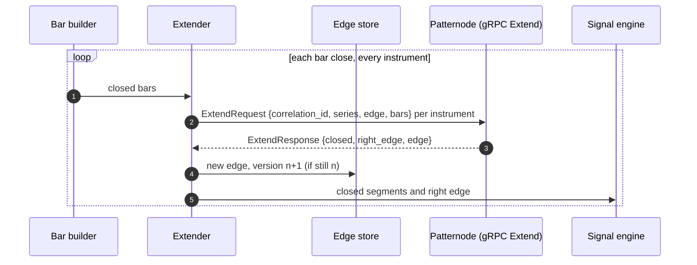
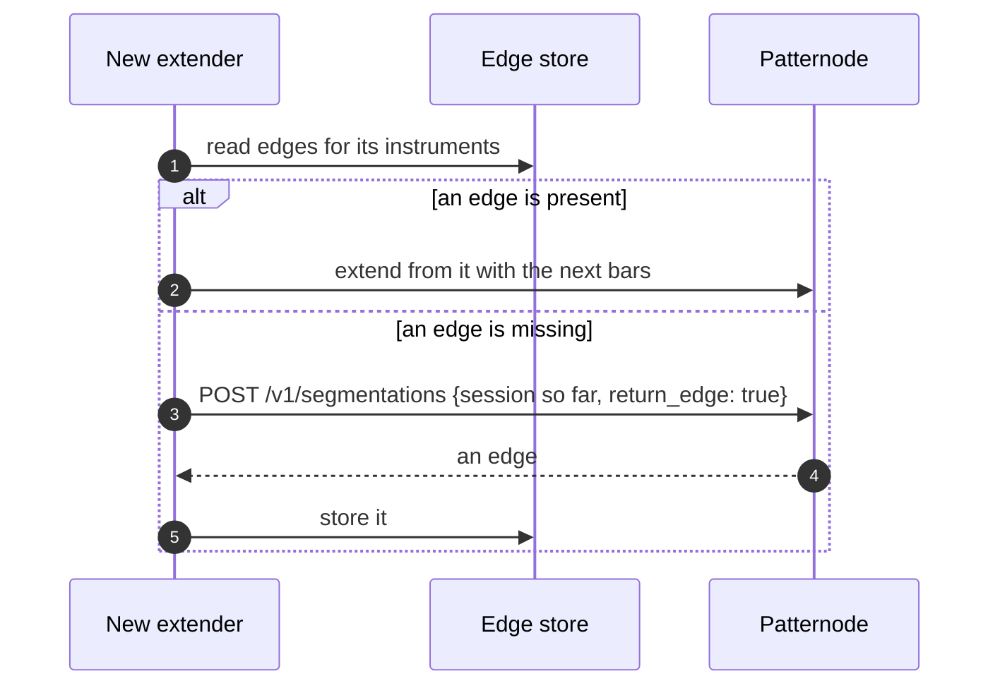

# Flows for a fund

## Backtest, then go live from where it ended

```mermaid
sequenceDiagram
  autonumber
  participant R as Research platform
  participant B as Your storage
  participant P as Patternode
  participant M as Model registry
  participant L as Live platform
  R->>B: Parquet per instrument; presign GET and PUT
  R->>P: POST /v1/segmentations/jobs {profile: standard@2026-11, return_edge: true, links}
  P->>B: GET the file, PUT the result (segments and the edge at its end)
  P-->>R: segmentation.job.succeeded
  R->>B: read results; build features; backtest
  R->>M: model, window, profile version
  Note over L: at the session start
  L->>P: POST /v1/segmentations {today so far, profile, return_edge: true}
  P-->>L: segments and an edge per instrument
  L->>L: edges into memory and the durable store
```

## The intraday loop



## Recovering an extender



The general flows, with every error and what to do, are in [Detailed flows](../flows.md).
