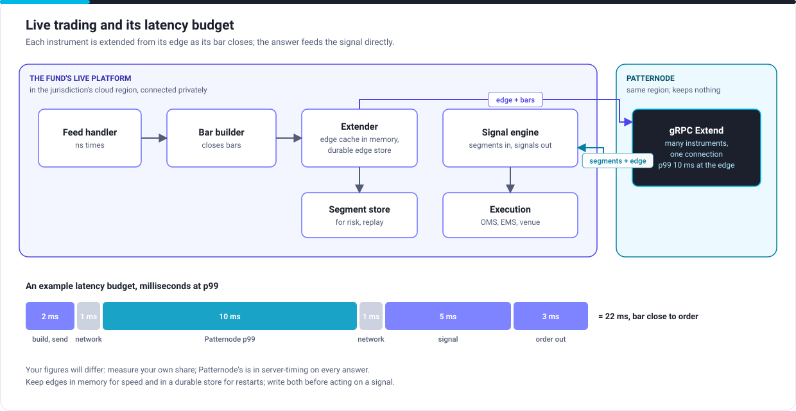

# Live trading

## The path

1. The feed handler normalises trades and quotes with nanosecond times.
2. The bar builder closes each instrument's bar on time.
3. The extender sends each closed bar with that instrument's edge. One gRPC connection carries every instrument (Mission Critical); batched REST does the same on any plan, up to 1,000 instruments a request.
4. The answer's closed segments and right edge go to the signal engine; its new edge replaces the old one in memory and in the durable edge store.
5. Signals go to execution as usual.

## Edges, in memory and at rest

| Where | Why | Rule |
|---|---|---|
| In memory, in the extender | Speed: the next bar needs it at once | One extender owns each instrument: partition instruments across extenders |
| A durable store (a key-value store, the segment store) | Restarts and failover of your own platform | Write the new edge before acting on the signal, with a version check, so a restarted extender never sends a stale edge |

If an edge is ever lost, send the instrument's session so far as a finished series with `return_edge: true`, and carry on from that edge. Nothing is lost at Patternode, because Patternode held nothing.

## The latency budget

Put your platform in the cloud region of your jurisdiction and connect privately; then the network is a millisecond or two each way. Patternode's p99 at the edge is 10 ms on Mission Critical (5 ms by agreement on Dedicated), and every answer's `server-timing` header gives Patternode's share, so you can see which part of a slow trade was whose. Measure your own parts the same way, and alert on the sum.

## When something fails

| Failure | What happens | Your platform |
|---|---|---|
| A Patternode region | Up to 60 seconds of resets or 503s, then answers from the other region | Resend the unanswered requests unchanged; the answers are the same |
| Patternode answers slowly | 429 or 503 with `retry-after` if over your rate | Resend after the wait; decide in advance whether a late segment still trades |
| A late bar | 409 `out_of_order`; nothing applied | Drop it; the edge is unchanged |
| Your extender restarts | | Read edges from the durable store and carry on |
| A bad tick makes a bad bar | It is applied: segments are final once closed | Filter bad ticks before the bar builder |

Next: [Reproducibility](reproducibility.md).
