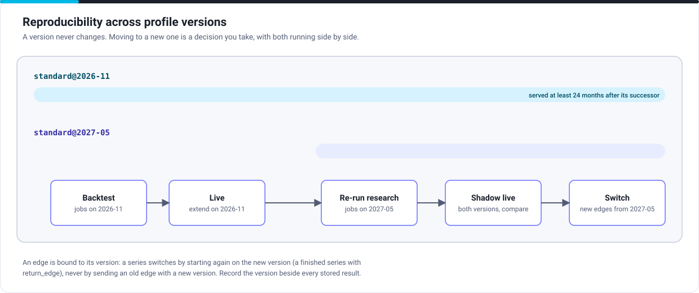

# Reproducibility

| Promise | What it means for you |
|---|---|
| The same bars and profile version give the same segments, bit for bit | A backtest's segments are exactly the segments live trading would have had |
| A profile version never changes | A result stored with its version can be reproduced at any time |
| Old versions are served for at least 24 months after a new one | You choose when to move, and can re-create any result in that time |
| A new version is announced in the changelog | Nothing changes under you |

## Pinning

Name the version in every request: `standard@2026-11`, never `standard`, in research and live. Record it beside every stored result and in the model registry with the model it fed. An edge is sealed with its version, and is refused with another (409 `edge_mismatch`).

## Moving to a new version

1. Re-run research on the new version as jobs, into a separate path of your storage.
2. Re-validate the models that use the segments, as your model risk policy asks.
3. Shadow live: run the new version beside the old for a period, from its own edges (a finished series of the session so far, with `return_edge`), and compare.
4. Switch the instruments to the new version's edges, and keep the old results with their version for audit.

## For model risk

For each profile version, Patternode provides under NDA a description of its inputs, outputs, known limits and changes from the previous version, for your model inventory and validation (SR 11-7, PRA SS1/23). The version string is the identifier to cite.

Next: [Operations and compliance](operations.md).
