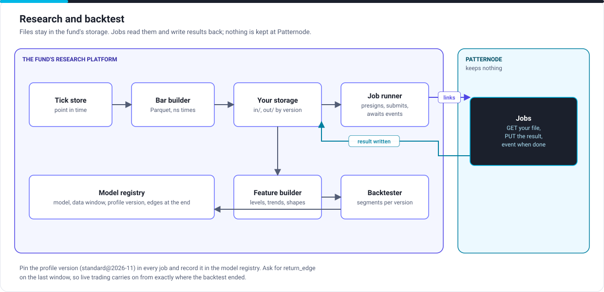

# Research and backtest

## The path

1. Build bars from your tick store, point in time, with nanosecond times. A second (or minute) with no trade is a gap, not a flat bar.
2. Write each series to Parquet in your storage, under a path that names the profile version: `out/standard@2026-11/eq/exmpl/1s.json`.
3. Presign a GET for the file and a PUT for the result, and submit a job per series with `profile` pinned. Run as many in parallel as your plan's concurrent jobs.
4. Take `segmentation.job.succeeded` from your webhook or event bus, and read the result from your storage.
5. Build features from the segments (levels, trends at several timescales, shapes) and backtest.
6. Record in the model registry the data window, the profile version, and for each series the edge at the end of the window (`return_edge: true` on the last job).

## Choices

| Choice | Recommendation |
|---|---|
| Bar width | The finest your strategy acts on; coarser views come from the higher levels, not from wider bars |
| One job per | Series and window. Re-running a window gives the same result, so a failed or lost run is re-run, not repaired |
| Storage layout | By profile version, then instrument, then bar width: results from two versions never mix |
| Cost | Charged by samples; a failed job is not charged; re-runs of a window cost the same each time, so cache results in your storage |

## What reaches Patternode

The bars of each series, read from your link for the time of the job, and nothing else. No universe definitions, no fundamentals, no labels, no strategy. Results are written to your link and not kept.

Next: [Live trading](live.md).
