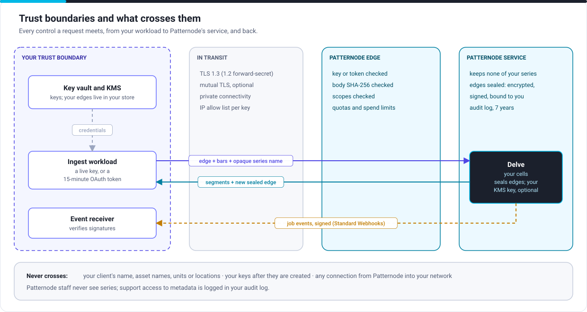

# Security and data

For enterprise architects, security architects and reviewers.

## Controls at each boundary

| Boundary | Controls |
|---|---|
| Your trust boundary | Credentials in your secret store; scoped, expiring keys per workload; or OAuth 2.0 client credentials with `private_key_jwt`, so no long-lived secret exists; secret scanning for the published key pattern |
| In transit | TLS 1.3 (1.2 with forward secrecy only for clients that need it); optional mutual TLS; private connectivity; an IP allow list per key |
| Patternode's edge | Credential checked before anything runs; SHA-256 of every write body checked; scopes checked; rate limits, quotas and spend limits enforced; a request id on every answer |
| Patternode's service | Keeps none of your series; seals each edge (encrypted and signed, bound to your account, series and profile version), optionally with your own KMS key; an audit log of every account change and support access, kept 7 years |
| Back to you | Events signed with HMAC-SHA256 to Standard Webhooks, with a timestamp to reject replays and overlapping secrets for rotation |

## Data

| Data | Crosses to Patternode | Kept by Patternode |
|---|---|---|
| Readings | As bars (times and four values) | No |
| Series names | Yes, opaque names you make up | With usage records |
| Client, asset, units, location, labels | Never | Never |
| Segments | Returned to you, or written to your storage by a job | No |
| Edges | Returned to you sealed; sent back by you with the next bars | No |
| Keys | Created at Patternode and shown once | A keyed hash only; Patternode cannot recover a key |
| Usage, audit | | Usage for billing; audit events for 7 years |

You need send no personal data at all. Patternode signs a data processing agreement in any case.

## For your review

| Question | Answer |
|---|---|
| Does anything of Patternode's run in our environment? | No. You run your own code, from published examples if you like |
| Does Patternode connect into our network? | No. Events reach an endpoint you expose or your event bus; jobs use links you sign, for the files you choose |
| Does Patternode keep our data? | No. Not series, segments, edges or results; only account, usage and audit metadata |
| Can we keep traffic off the internet? | Yes, with private connectivity on Mission Critical and Dedicated |
| Can we hold the encryption key? | Yes, on Mission Critical and Dedicated: your key seals your edges, so revoking it makes them unreadable to Patternode |
| Assurance | SOC 2 Type II and ISO/IEC 27001, an annual penetration test, a subprocessor list ([Compliance](../service/compliance.md)) |
| Regimes | DORA, UK operational resilience, NERC CIP, IEC 62443, the privacy acts ([Compliance](../service/compliance.md#regimes)) |

Next: [Reference architectures](reference-architectures.md).
