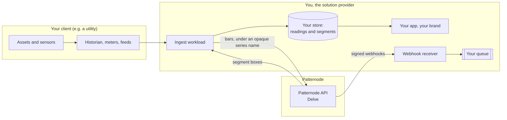

# Architecture, from the outside

Patternode is a black box with a contract. This page describes everything you can see from outside it, which is everything you need to integrate.

## Three parties

| Party | Owns | Runs |
|---|---|---|
| Your client | The assets, the readings, the relationship with you | Their historian, meters and feeds |
| You | Your app, your backend, your storage and your keys | The ingest workload, the shard store, the webhook receiver, the app that draws |
| Patternode | The service | Segmentation, and for each forming series a checkpoint of its open right edge |

Nothing in the browser computes a segment. Your backend asks Patternode, stores what comes back beside your own data, and your app draws from your store.

## What crosses the boundary

| Direction | What | Not |
|---|---|---|
| You to Patternode | Bars (or samples) and a series name you made up | Your client's name, the asset, units, location, anything else |
| Patternode to you | Segment boxes: place in the tree, open, high, low, close with their times | Anything of how they were found |
| Patternode to you, by webhook | Job and account events, signed | Your data |

The detail is on [Data boundary](data-boundary.md).

## The products, as layers

Delve is the foundation: the shards of a series. Essence, Sentinel and Foresight, when they ship, will read the same shards, so a series you have sent to Delve will not need sending again. The API is one API, with product-neutral resources, so your keys, client, webhook receiver and infrastructure serve every product.

## How this site maps to the Architecture Continuum

Patternode's own architecture follows the Architecture Continuum, from context to running code. This site is its outside view: the same levels, showing only what a partner integrates with.

| Level | Here |
|---|---|
| Context: parties, products, boundary | This page, [Products](products.md), [Data boundary](data-boundary.md) |
| Building blocks: what you build on your side | [Partner building blocks](../guides/building-blocks.md) |
| Patterns: how the blocks work together | [Integration patterns](../guides/integration-patterns.md) and one page per pattern |
| Interfaces: the contracts | [API reference](/api/patternode-api) (`specs/openapi.yaml`), [Events](../events/index.md) (`specs/asyncapi.yaml`), `specs/schemas/` |
| Golden path: the supported route | [Delve onboarding playbook](../playbooks/delve-onboarding.md) |
| Recipes: one stack, configured | [AWS with Terraform](../guides/aws-terraform.md) |
| Code | `examples/`, `mock/`, run in CI |
| Industry overlays: the same, for one industry's data | [Utilities](../industries/utilities.mdx), [Finance](../industries/finance.mdx) |
