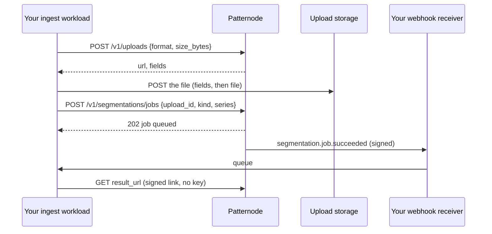

import CodeBlock from '@theme/CodeBlock';
import src from '!!raw-loader!@examples/python/bulk_job.py';

# Backfill

| File | Format |
|---|---|
| `jsonl` | One bar (or sample) a line, as JSON: `[1730246400000,1730249999000,412.0,430.5,405.2,428.1]` |
| `csv` | A header row, then `open_time,close_time,open,high,low,close` (or `time,value`) |

- Declare `size_bytes`: it is what counts against the day's upload bytes, and storage accepts no more.
- One series per file. Run series in parallel up to your tier's concurrent jobs.
- A failed job is not charged; `error.details.problems` lists the bad rows.
- The result link lasts 24 hours. Fetch and store it when the webhook arrives.

<CodeBlock language="python" title="examples/python/bulk_job.py">{src}</CodeBlock>
