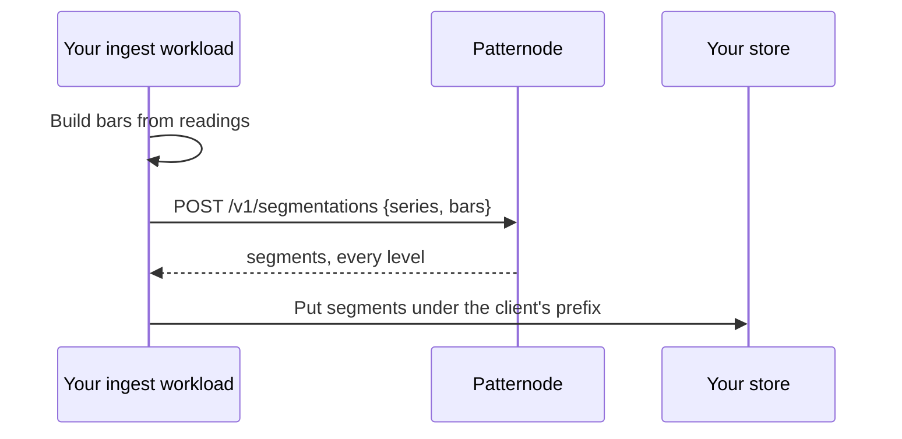

import CodeBlock from '@theme/CodeBlock';
import src from '!!raw-loader!@examples/python/finished_series.py';

# Finished series

1. Build bars from your readings, leaving gaps where nothing happened ([Shards and bars](../concepts/shards.md)).
2. Name the series opaquely ([Data boundary](../concepts/data-boundary.md#naming-series)).
3. Send it. Up to 5 MB of body answers at once; past that, use a [backfill](backfill.mdx).
4. Store the segments beside your readings, keyed by series and level, so a chart reads only the level it draws.
5. When more bars arrive, either send the window again (simple, and fine for daily redraws) or ask for `return_edge: true` and carry the series on as a [forming series](forming-series.mdx).

Only the provisional segments can change on a resend of a longer window. Final segments keep their ids, so a store keyed on `id` updates in place.

<CodeBlock language="python" title="examples/python/finished_series.py">{src}</CodeBlock>
