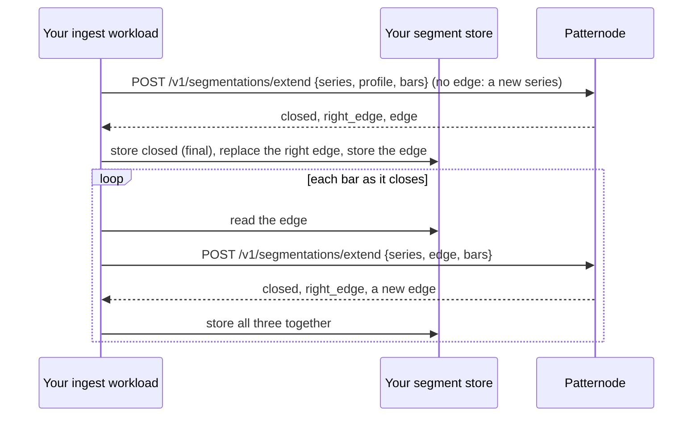

import CodeBlock from '@theme/CodeBlock';
import src from '!!raw-loader!@examples/python/forming_series.py';

# Forming series

:::info Preview
This route works and may change with 30 days' notice. Do not build production alarms on it yet.
:::

Patternode keeps nothing between calls, not even for a series that is still forming. The series carries itself: each answer returns its edge, a sealed token holding the open right edge of every level. You store the edge with the segments, and send it back with the next bars.

| In the answer | Means | Do |
|---|---|---|
| `closed` | Segments these bars closed, now final | Store them; they never change |
| `right_edge` | The open segment at each level, provisional | Replace the previous right edge with it |
| `edge` | The series' state, sealed by Patternode | Store it as it is; send it back with the next bars |
| `edge_last_close_time` | When the last bar closed | The next bars must open after it |
| `outcome` | `started`, `extended` or `segmented` | Redraw when `segmented` |

Rules:

- The edge is sealed: encrypted and signed, bound to your account, the series and the profile version. It is no use to anyone else, and a changed edge is refused (400 `edge_invalid`); an edge sent for another series is refused (409 `edge_mismatch`).
- Bars must open after the edge's last bar closed; otherwise 409 `out_of_order`, and nothing is applied.
- The same edge with the same bars always gives the same answer. A timeout is safe to retry: resend the request you sent.
- Store the closed segments, the right edge and the edge together, in one write. One writer per series: if two writers extend from the same edge, keep the first write (a version check, as [the segment store](segment-store.mdx) does).
- A finished series can become a forming one: ask `POST /v1/segmentations` for `return_edge: true` and carry on from that edge.
- Many series at once: `POST /v1/segmentations/extend/batch` takes up to 1,000 items, each with its own edge.

Extending a series bar by bar, in any pieces, gives the same segments as sending all its bars as one finished series.

<CodeBlock language="python" title="examples/python/forming_series.py">{src}</CodeBlock>
