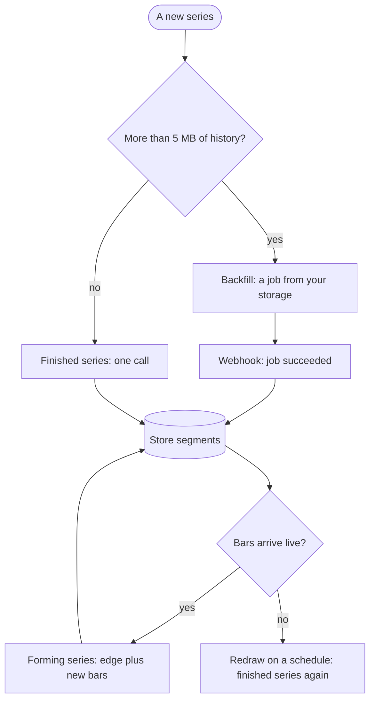

# Integration patterns

| Pattern | Use when | Calls | Status |
|---|---|---|---|
| [Finished series](finished-series.mdx) | You have a window of history and want every level to draw from | `POST /v1/segmentations` | Available |
| [Forming series](forming-series.mdx) | Bars arrive live and you want each segment as it closes | `POST /v1/segmentations/extend`, with the edge | Preview |
| [Backfill](backfill.mdx) | Years of history, or bodies over 5 MB | `POST /v1/segmentations/jobs`, from and to your storage | Available |
| [Webhooks](webhooks.mdx) | You run jobs, or want account events | Your endpoint | Available |

Most integrations use three: a backfill once per series, extensions from its edge from then on, and webhooks for the jobs. A reporting product that redraws daily can use finished series alone.

All four use the same key, client, body hash and error handling ([Requests, errors and limits](../concepts/requests.md)).
