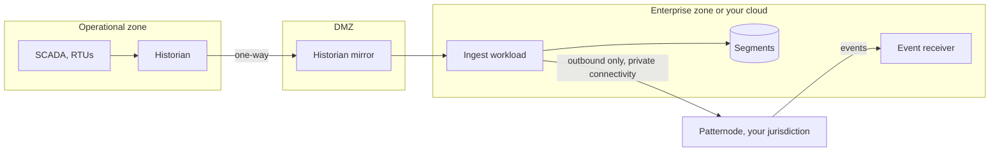

import CodeBlock from '@theme/CodeBlock';
import src from '!!raw-loader!@examples/industries/utilities/historian_to_delve.py';

# Utilities

For monitoring products and operational tools on historian, SCADA and meter data: transmission and distribution, generation fleets, water and wastewater networks, gas.

## Your data, as Delve reads it

| You have | Send | Notes |
|---|---|---|
| A process historian's archive (PI, eDNA, Canary, a SCADA historian), compressed | Bars built from the points it kept, as kept | Do not interpolate onto a grid first: each kept point marks a change |
| Points with quality codes | Only good-quality points | Map your historian's codes; a bad point is a gap, not a value |
| A measure that crosses zero (net export, reactive power, temperatures below zero) | The measure plus a fixed offset | Remove the offset when you draw |
| Interval meter reads (5, 15 or 30 minutes) | One bar per read interval, or per hour | An interval with no flow is a gap |
| Status points (breaker open or closed, pump running) | Not Delve's input | Draw them beside the segments from your own store |

| Asset view | Bar width that usually fits |
|---|---|
| A substation or plant over days to weeks | 15 minutes |
| A feeder or inverter over hours to days | 1 to 5 minutes |
| A fleet over months | 1 hour |

## The plan for the job

| Use | Plan |
|---|---|
| An engineering or asset-management product, used in office hours | Production |
| A tool in the control room, used in real-time operations | Mission Critical, in your jurisdiction, with private connectivity |
| A transmission operator, or anything your regulator treats as critical outsourcing | Dedicated |

Register your emergency conditions (a storm declaration, a system emergency) as blackout periods, so Patternode changes nothing while you are in one. Plan capacity for the storm, not the calm day: every point reporting at once, and backfills after an outage.

## Where it sits in your network

Patternode never needs a connection into your operational network. Your systems call out from the enterprise zone or a DMZ, and events come back to a broker or endpoint you control there. That keeps Patternode outside your NERC CIP electronic security perimeter and outside the control zones of an IEC 62443 design.



## Example

`examples/industries/utilities/historian_to_delve.py` reads an invented historian export of a zone substation transformer (top-oil temperature and load, compressed points with quality codes). It drops bad points, builds 15-minute bars from the kept points, names each series opaquely, sends the history as finished series with a pinned profile version and its edge, and then extends every tag in one request, each from its stored edge, as each interval closes. Patternode keeps nothing.

```bash
python mock/mock_patternode.py &
PATTERNODE_API_KEY=pnk_live_BBBBBBBBBBBBBBBBBBBBBBBBBBBBBBBBBBBB python examples/industries/utilities/historian_to_delve.py
```

<CodeBlock language="python" title="examples/industries/utilities/historian_to_delve.py">{src}</CodeBlock>

## What you will be asked

| Question | Answer |
|---|---|
| Does data leave the country? | No: choose the jurisdiction ([Resilience](../service/resilience.md#jurisdictions)) |
| Does Patternode connect into our OT network? | No: outbound only, as above ([Compliance](../service/compliance.md)) |
| What does Patternode see? | Bars under names you made up ([Data boundary](../concepts/data-boundary.md)) |
| Can an audit reproduce what operators saw? | Yes: pin the profile version ([Determinism](../service/realtime.md#determinism)) |
| What happens in a regional outage? | It fails over within 60 seconds on Mission Critical, losing nothing acknowledged ([Resilience](../service/resilience.md)) |
